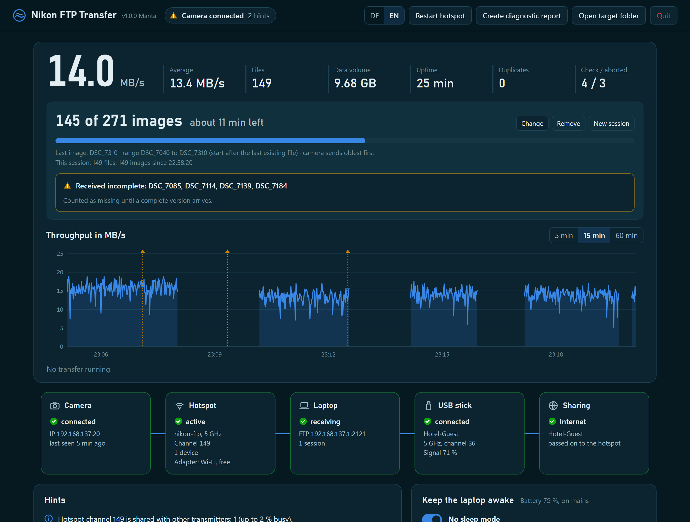
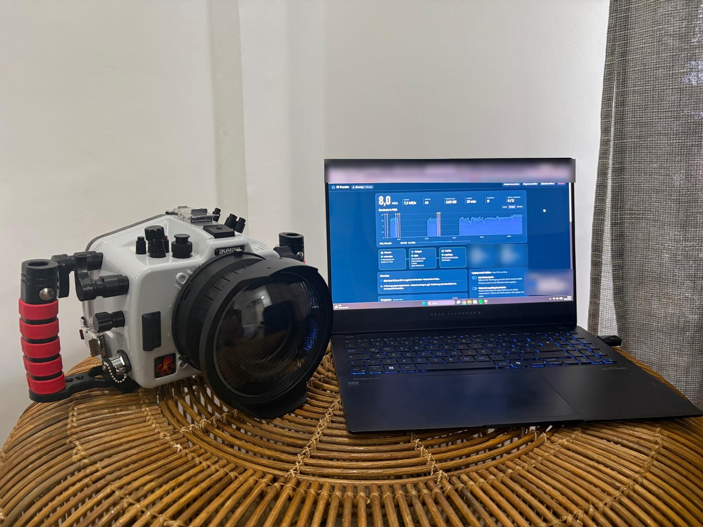

# Nikon Windows Hotspot FTP Transfer

Wireless photo transfer from a Nikon camera to a Windows laptop: the laptop opens its own 5 GHz hotspot, the camera joins it and uploads via FTP, and a small dashboard shows what is happening. No router, no cable, no Nikon software.



## Why this exists

The Nikon Z8 has two USB-C ports: one for power delivery and one for data. That is great until the camera sits in an underwater housing with a single USB-C bulkhead. You use that one port to charge, so while the housing is closed there is no way to get images off the card.

The camera can upload over Wi-Fi via FTP, though. This tool turns a Windows laptop into the other end of that connection, so after a dive you plug in the charger, start the tool and watch the images arrive.



*The real setup: the Z8 stays sealed in its housing and uploads straight to the laptop.*

Why not Nikon's *Wireless Transmitter Utility*? On my laptop it simply would not start. FTP is an open standard, and owning the receiving side means errors can be caught, checked and explained.

## What it does

- **Starts the Windows Mobile Hotspot on 5 GHz** and frees the internal Wi-Fi card for it, then restores everything on exit.
- **Runs the FTP server** only on the hotspot network. Files arrive as `.part`, get checked (NEF/TIFF structure, JPEG end marker), and are renamed only when complete.
- **Skips duplicates** by content, even if the camera re-sends files or renames them, and **replaces truncated files** automatically when the camera sends them again.
- **Progress and remaining time.** You enter what is coming today (files in the upload, last image number, or images on the card), and at the end it tells you exactly which numbers are missing.
- **Dashboard** at `http://127.0.0.1:8765` with throughput chart, connection chain (camera, hotspot, laptop, USB stick, internet), Wi-Fi channel usage, per-file chart, hints and a one-click diagnostic report.
- **Keeps the laptop awake** during the transfer and up to 10 minutes after it, optionally even with the lid closed.

Measured with a Z8 and 64 MB NEFs: about **14 MB/s** on the 5 GHz hotspot. With the camera as access point it fell back to 2.4 GHz at 72 Mbit/s link rate, which is several times slower.

## Requirements

- Windows 10 or 11 with a Wi-Fi card that can host a 5 GHz hotspot.
- A Nikon camera with built-in FTP upload. Tested with the **Z8**. Other Nikon models with FTP should work the same way but are untested. Feedback is welcome.
- Recommended: a **second Wi-Fi adapter** (any 5 GHz USB stick) if you want to keep internet access, see [Network setups](#network-setups).

## Quick start

1. Download `NikonFTPTransfer.exe` from [Releases](../../releases) and run it. Windows SmartScreen may warn about an unknown publisher, because the exe is not code-signed: *More info → Run anyway*. Alternatively run from source, see [Development](#development).
2. Allow the firewall prompt, including **public networks**, because Windows classifies the hotspot network as public.
3. The dashboard opens in your browser (English or German, see below). The **Camera profile** panel shows exactly what to enter in the camera.
4. Set up the camera once (below), then start the upload on the camera.

On first start a `config.json` is created next to the program, with a random FTP password.

## Camera setup (Z8)

Menu names as in the English Z8 manual:

1. **Network menu → Router frequency band → 5 GHz**. This makes sure the camera joins the hotspot on 5 GHz.
2. **Network menu → Connect to FTP server → Network settings → Create profile → Connection wizard**.
3. Name the profile, choose **Search for Wi-Fi network**, select the hotspot SSID (default `nikon-ftp`) and enter the Wi-Fi password shown in the dashboard.
4. IP address: **Obtain automatically**.
5. Server type **FTP**, address **`192.168.137.1`**, port **`2121`**.
6. **Enter user ID**: user `nikon` and the FTP password from the dashboard.
7. Destination: **Home folder**.

The profile name turns green when connected. Under **Options**, you can use **Upload folder** to send a whole folder, keep **Overwrite if same name** off, and consider **Keep connection** (it retries about every 15 s, but drains the battery faster).

Why not let the camera be the access point? In access-point mode my Z8 only offered 2.4 GHz channels, and 2.4 GHz is slow and crowded.

## Network setups

If the Wi-Fi card that hosts the hotspot is also connected to the hotel Wi-Fi, the hotspot has to use the hotel's channel. In my tests the camera failed with `Err.1F` in that situation. The tool therefore disconnects the hotspot card from all networks while it runs.

**A) Two Wi-Fi adapters (recommended).** The internal card hosts the hotspot, and a USB Wi-Fi stick stays connected to the hotel network for internet. The stick also scans the surrounding channels for the dashboard.

**B) One Wi-Fi adapter, no internet.** Windows only starts the hotspot when it has a connection to "share". Without one, there are two ways around it:
- connect a second adapter (or LAN cable) to any network, e.g. your phone's hotspot, or
- install the **Microsoft KM-TEST Loopback Adapter** once. It is a fake network that gives Windows something to share. The dashboard offers a **Set up loopback** / **Enable loopback** button that opens the Windows hardware wizard (admin rights): install manually from a list → Network adapters → Microsoft → Microsoft KM-TEST Loopback Adapter.

## Using the dashboard

**What's coming today?** Pick one:

| Input | Example | How it counts |
|---|---|---|
| Files in upload | `214` | Exact. The number the camera shows when the upload starts; every file counts. |
| Last image | `DSC_7310` | Range from the image after the newest file already in the target folder up to this number. RAW+JPEG with the same number count once, and 9999 → 0001 is handled. |
| Images on card | `1 of 1900` | The total from the camera's playback. Images already transferred count too. The card is located via the first files that arrive, and you can correct the first image if needed. |

When nothing has been transferred for a minute and images are still missing, the tool lists the missing numbers and asks whether that is fine (deleted in camera) or whether they are really missing and you will upload them again.

In-camera **File number sequence** should be on, otherwise numbering restarts at 0001 after formatting.

## Troubleshooting

| Symptom | Cause / fix |
|---|---|
| Camera shows `Err.1F` (wireless error) | Hotspot card was connected to another network and the hotspot inherited its channel. Let the tool manage the card (default) or disconnect it manually. |
| Slow, around 2–5 MB/s | Camera is on 2.4 GHz. Set **Router frequency band** to 5 GHz, check the hotspot band in the connection chain, and move the laptop closer. |
| Hotspot will not start | No connection to share. See [Network setups B](#network-setups). A VPN can also block sharing, so disconnect it. |
| Camera joins Wi-Fi but no FTP connection | Firewall: allow the program on **public** networks (some antivirus suites have their own firewall). Check address, port and PASV in the camera profile. |
| Port in use (`WinError 10013/10048`) | Another FTP server is running (e.g. an old one on port 21). The default is port 2121, or change `ftp_port`. |
| Passive-mode errors | Windows reserves some port ranges (`netsh interface ipv4 show excludedportrange protocol=tcp`). The default passive range 40000–40100 avoids the common ones. |
| Channel scan empty or "from Windows cache" | Recent Windows 11 builds may require **location services** for Wi-Fi scans (Settings → Privacy & security → Location). The hotspot's own channel is usually hidden from scans. |
| Anything else | Click **Create diagnostic report** and attach it to an issue. Logs are in `<target>/_transfer/`. |

Check that keep-awake works with `powercfg /requests` in an admin terminal while transferring.

## Configuration

`config.json` next to the program (see `config.example.json`):

| Key | Default | Meaning |
|---|---|---|
| `ssid`, `passphrase` | `nikon-ftp`, empty | Hotspot name and Wi-Fi password (empty keeps the Windows one) |
| `hotspot_adapter_match` | empty | Empty picks the internal (non-USB) card automatically. Otherwise part of the adapter name. |
| `ftp_port`, `pasv_ports` | `2121`, `[40000, 40100]` | FTP control and passive data ports |
| `user`, `password` | `nikon`, random | FTP login |
| `target` | `~/Pictures/Nikon-FTP-Import` | Where images go |
| `keep_awake`, `awake_idle_min` | `true`, `10` | Block sleep while transferring and N minutes after (0 = always) |
| `lid_keep_running` | `false` | Lid closed = keep running |
| `file_pattern`, `number_max` | Nikon naming, `9999` | How image numbers are read from file names |
| `language` | `auto` | Dashboard language: `auto` (Windows display language), `de` or `en` |

## Development

```
pip install -r requirements.txt
python nikon_ftp_transfer.py                 # run (Windows)
python tests/test_progress.py                # tests, any OS
python tests/test_i18n.py                    # translation tests, any OS
NFT_TEST=1 NFT_DEMO=1 python nikon_ftp_transfer.py   # dashboard with invented demo data, any OS
python nikon_ftp_transfer.py --check <folder>        # verify existing NEF/JPEG files
build_exe.cmd                                # build dist\NikonFTPTransfer.exe
```

Pushing a tag `v*` builds the exe on GitHub Actions and attaches it to a release.

The dashboard is available in English and German. It follows the Windows display language, and the DE/EN switch in the header changes it (config key `language`). Translations live in `locales/*.json`; new languages are welcome: copy `en.json`, translate it and add the language code to `LANGS` in `nikon_ftp_transfer.py`.

## About this project

This tool was largely written by an AI (Anthropic's Claude) in conversation with me, and then tested and used in real life. Not affiliated with or endorsed by Nikon. Nikon is a trademark of its owner. MIT licensed, see [LICENSE](LICENSE).
